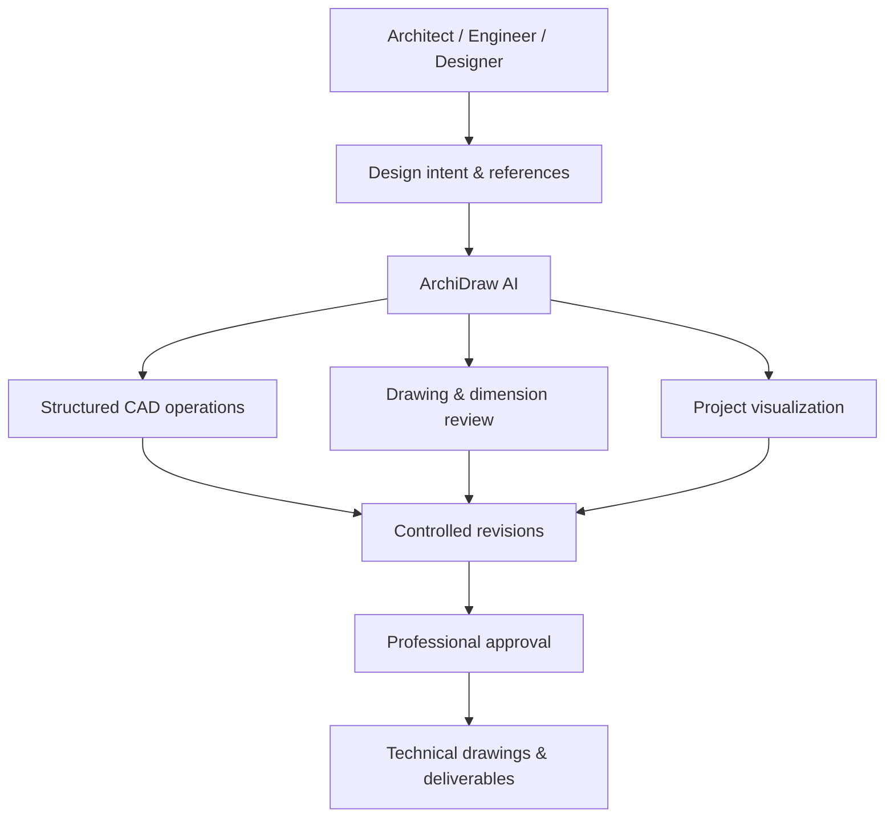

# ArchiDraw AI

### Architecture meets intelligence.

**ArchiDraw AI is an intelligent architectural and technical drawing environment that connects natural-language interaction with structured CAD workflows.**

From a design brief to technical drawings, ArchiDraw AI explores a more direct way for architects, engineers, and technical designers to create, inspect, refine, and communicate their work—while keeping geometry, measurements, revisions, and professional judgment at the center.

**AI-assisted design. Real CAD geometry. Human control.**

---

## What is ArchiDraw AI?

Traditional CAD tools are powerful, but working with them can involve repetitive drafting, fragmented reviews, and complex interfaces. ArchiDraw AI brings conversational interaction into the technical design process.

A professional can describe an intended change, examine its effect on the drawing, review dimensional and geometric consistency, and iterate on a project through a combination of visual interfaces and AI-assisted tools.

The objective is not to replace architects or engineers. It is to make their technical work more accessible, efficient, and verifiable.

## Explore the possibilities

### Conversational CAD

Translate design intent into structured drawing operations. Work with architectural elements such as walls, doors, windows, dimensions, and other drawing references through an AI-assisted interface.

### Drawings that remain technical

ArchiDraw AI is designed around CAD geometry rather than illustrative approximations. Dimensions, spatial relationships, and drawing conventions are treated as technical information—not decoration.

### From references to refined plans

Use sketches, plans, and survey references to guide a review process: compare source information with a drawing, identify differences, validate proposed changes, and refine the result.

### Architectural documentation

Bring together floor plans, dimensions, axes, openings, room information, sections, elevations, and sheet composition as part of a coherent technical drawing workflow.

### Reviewable revisions

Explore changes without losing the relationship to the original project. Revision history, controlled edits, and visual review support more deliberate decisions.

### Visual and material exploration

Technical projects benefit from more than one view. ArchiDraw AI explores coordinated drawing views, component libraries, materials, and 3D-assisted inspection where appropriate.

### AI-native interoperability

Through the **Model Context Protocol (MCP)**, ArchiDraw AI connects conversational assistance with specialized technical drawing capabilities. The vision is a design environment where natural-language interaction and professional tools complement one another.

---

## How the experience fits together

*This is a product-level conceptual view, not a disclosure of internal implementation.*

## Designed for professional workflows

ArchiDraw AI's design language is informed by real architectural drafting practice: meaningful lineweights, dimension hierarchies, axes, plan annotations, clear views, and printable technical sheets.

A design assistant should understand that a wall thickness, door swing, elevation marker, and sheet scale are not merely visual details. They are part of a professional technical document.

## A connected workspace

The product vision brings together:

- **ArchiDraw Studio** — project-oriented visual workflows and technical review.
- **Conversational interaction** — design intent expressed in natural language.
- **CAD intelligence** — structured drawing operations and geometry-aware checks.
- **Project references** — surveys, existing drawings, and design context.
- **Visualization** — technical previews, drawing views, and component inspection.
- **Professional oversight** — explicit review before accepting consequential changes.

Some experiences are implemented in the development environment; others remain under active development or controlled validation. Availability varies by workflow and deployment.

## Our approach

**Precision over appearance.** Technical values must come from drawing data.

**Assistance over autonomy.** AI supports professional decisions; it does not certify them.

**Traceability over guesswork.** Proposed changes should be reviewable and tied to project state.

**Interoperability over lock-in.** The architecture aims to connect established CAD workflows with modern AI interfaces.

**Ownership and privacy.** The long-term direction emphasizes user control of project files and carefully bounded processing.

## Learn more

- [Product architecture](docs/architecture.md)
- [Technical drawing workflow](docs/workflow.md)
- [Validation and professional oversight](docs/validation.md)
- [Product direction](docs/roadmap.md)

## Public architecture, private technology

This repository is the public architectural and product presentation of **ArchiDraw AI**. It does not distribute the commercial application's source code, private project data, internal algorithms, credentials, or operational infrastructure.

Public documentation does **not** mean the underlying software is open source. See [Intellectual Property](INTELLECTUAL_PROPERTY.md), [License](LICENSE), and [Security](SECURITY.md).

---

**ArchiDraw AI — From design intent to technical clarity.**
