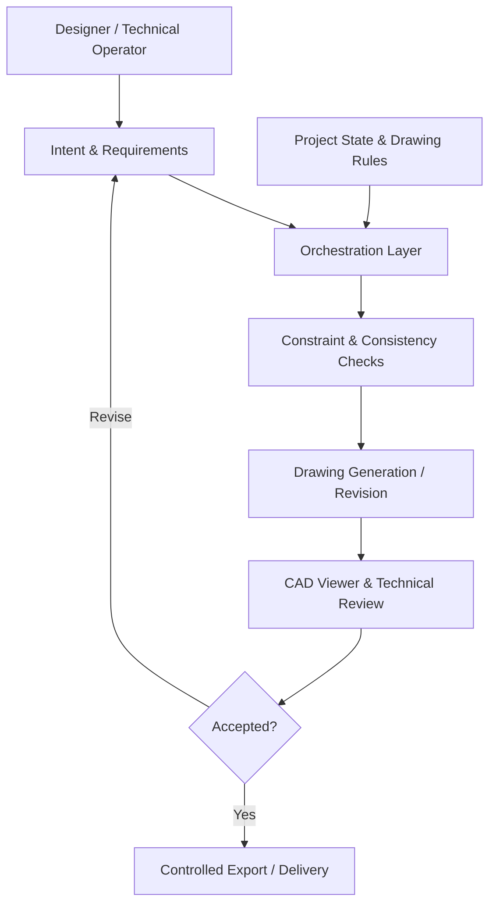

# ArchiDraw AI

**Architecture-first technical drawing and CAD assistance**

ArchiDraw AI explores an AI-assisted workflow for producing, reviewing, and validating architectural technical drawings. This public repository documents the **system architecture and design principles**, not the proprietary implementation.

> Public architecture. Private implementation.

## Vision

Bridge natural-language design intent and verifiable technical drawings through explicit constraints, structured project state, controlled transformations, and reviewable outputs.

## Conceptual architecture

The diagram is a **high-level conceptual model**. It is not a disclosure of production services, internal APIs, model configuration, or deployment topology.

## Design principles

- **Human-in-the-loop:** technical approval remains with qualified people.
- **Explicit project state:** changes should be traceable to a known revision.
- **Constraint-aware design:** drawing conventions and dimensions are treated as verifiable requirements.
- **Reversible iteration:** review and correction precede final delivery.
- **Separation of concerns:** AI interpretation, drawing operations, validation, and visualization have distinct responsibilities.
- **Interoperability by design:** integration boundaries can be described without publishing private protocols.

## Documentation

- [System architecture](docs/architecture.md)
- [Technical drawing workflow](docs/workflow.md)
- [Validation and human oversight](docs/validation.md)
- [Roadmap and maturity](docs/roadmap.md)
- [Public documentation scope](INTELLECTUAL_PROPERTY.md)
- [Security reporting](SECURITY.md)

## Project status

ArchiDraw AI is under active development. The diagrams in this repository describe the intended architectural approach; they are **not a certification of building-code compliance or an inventory of shipped features**.

## Source code and intellectual property

This is **not an open-source software release**. No production application source code, model prompts, credentials, private datasets, customer drawings, infrastructure configuration, or sensitive integration details are distributed here.

See [INTELLECTUAL_PROPERTY.md](INTELLECTUAL_PROPERTY.md) and [LICENSE](LICENSE).
