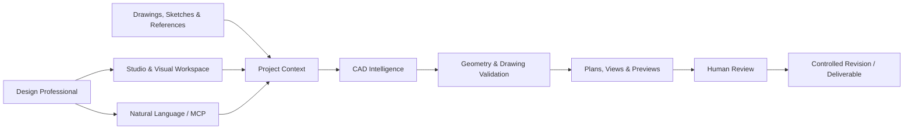

# ArchiDraw AI — Product Architecture

ArchiDraw AI is conceived as a connected environment for technical design, combining conversational interaction, structured CAD operations, project context, visual review, and professional validation.

## Experience architecture

This diagram communicates product responsibilities rather than private system topology.

## Core capabilities and design areas

### Intent and context
Capture the designer's requirements, relevant project references, drawing conventions, and expected changes.

### Geometry-aware drafting
Operate on structured technical entities—walls, openings, dimensions, and drawing references—rather than manipulating a flat illustration.

### Technical representation
Connect the underlying drawing to readable plans, axes, annotations, elevations, sections, and print-oriented composition.

### Visual review
Support inspection of drawings and proposed changes, including reference-based refinement and coordinated views.

### Revision control
Preserve an auditable relationship between a project state, a proposed modification, and a reviewed result.

### Professional validation
Assist with consistency checks while retaining responsibility for design approval, regulations, safety, and engineering calculations with qualified professionals.

## Integration philosophy

The Model Context Protocol (MCP) provides a way to connect AI-assisted interaction with specialized design operations. The product direction also includes a visual Studio experience and user-controlled project storage.

These are architectural goals and development areas, not a claim that every integration or deployment mode is generally available.

## Intellectual property boundary

This repository intentionally omits production source code, private algorithms, internal service contracts, project data, credentials, security controls, and deployment details.
