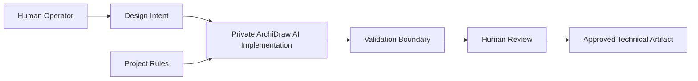

# System Architecture

## Logical layers

1. **Interaction:** designer intent, constraints, revisions and review feedback.
2. **Project context:** versioned drawing state, conventions and technical requirements.
3. **Orchestration:** coordination of interpretation and drawing operations.
4. **Validation:** checks for consistency, dimensions and applicable project rules.
5. **Visualization:** inspectable technical drawing and revision comparison.
6. **Delivery:** controlled export after human acceptance.

These are conceptual responsibilities, not claims about individual deployed microservices or internal implementation.

## Boundaries

The private implementation boundary intentionally hides algorithms, infrastructure, internal tools, API contracts and sensitive data.

## Integration philosophy

External CAD and AI tooling may connect through controlled interfaces. The public repository does not publish private endpoint schemas, credentials, tool identifiers or operational controls.
