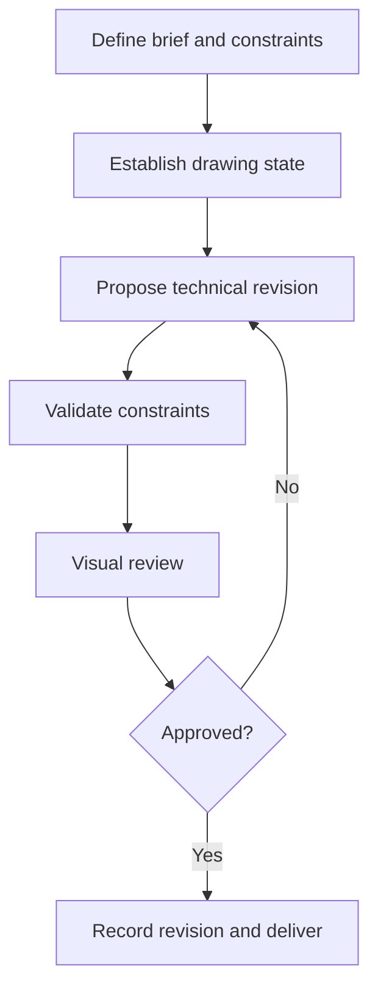

# Technical Drawing Workflow

A drawing is not considered technically approved merely because an AI system generated it. Dimensional, regulatory, structural and safety requirements require appropriate professional verification.

## Revision discipline

- Maintain an identifiable baseline.
- Describe each proposed change and its scope.
- Validate against explicit project rules.
- Preserve a human acceptance step.
- Keep exported deliverables distinguishable from working drafts.
